# B21 Print

An Android app for the NIIMBOT B21 Pro label printer. It prints photos and text signs over
Bluetooth, with no account, no cloud catalog and no RFID roll check, and it has a photo booth mode
for tablets.

<p>
  
  
</p>

<p>
  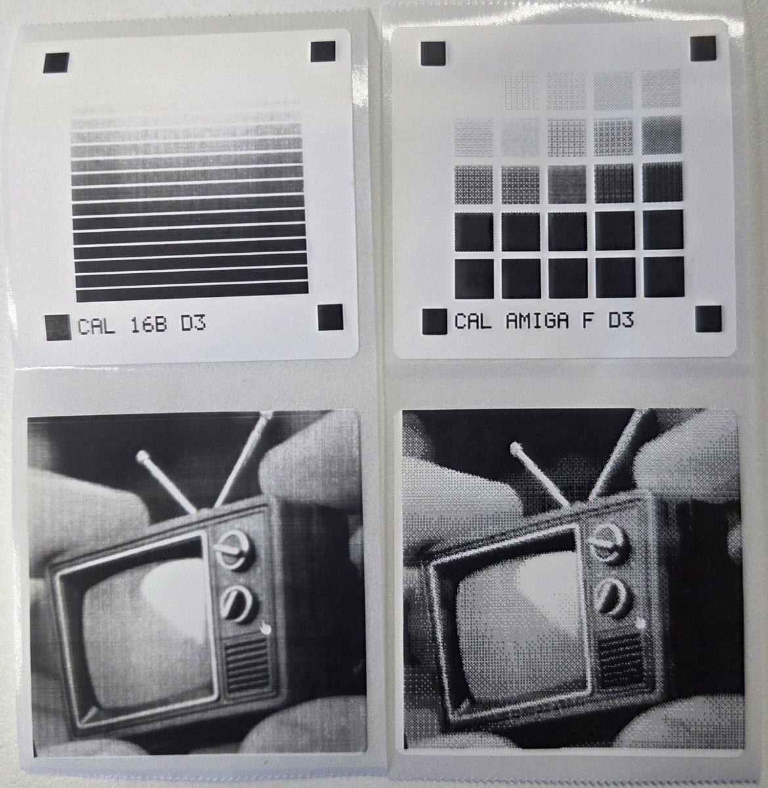
  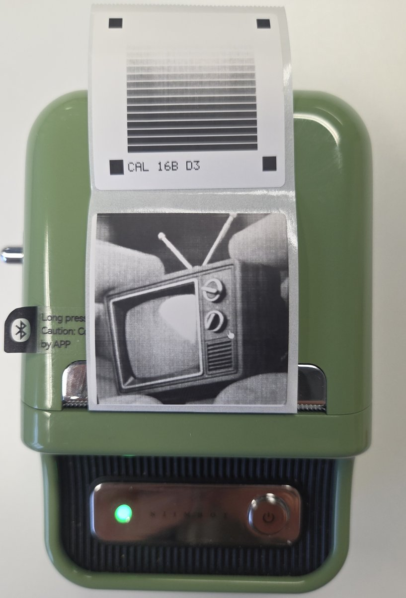
</p>

Real prints on third-party 40 × 40 mm labels. First photo: the 16-level gray mode (left) and
*Amiga fine*, 1-bit (right), each under its calibration chart. Second photo: a gray print straight
out of the printer. The gray prints were made with a patched printer firmware (see *Gray mode*).

## Features

**Photos**
- Camera, gallery, or *Share* from any other app; crop to the label shape or freely
- 16-level gray printing (*Fine*) or 1-bit dithering (*Coarse*), twelve raster looks (see below),
  brightness, contrast, invert, favourites
- Gray on plain standard labels, which the manufacturer's app does not offer at all, not even on
  NIIMBOT's own RFID labels (needs a printer firmware without the RFID roll check). Gray gets much
  better with a patched printer firmware (see *Gray mode*); the app works with the original
  firmware too
- Paper profiles: tone curves measured in the app from a photo of a printed chart, picked
  automatically by the roll's RFID tag
- Portrait photos from Samsung phones: the depth map splits subject and background; the background
  can print lighter, darker, in another raster or red
- Red and black on two-colour rolls: a band of image tones, set with a slider, prints red
- Soft edge: the photo fades to white towards its border, round on circle labels
- Instant frame with an optional caption, printed by the app on plain labels; the frame can be
  black, with white caption and stamp
- Stamp: the date and time or a short text (up to 32 characters, one line, pixel font) at the bottom
  right, punched into the picture in white or black (also in the window of Memory Film labels), or
  set into the instant frame
- Landscape: non-square labels can be laid out and printed turned, clockwise or counter-clockwise
- Panorama: one photo or sign spread over 1–6 labels printed one after another, with an optional gap
  compensation for the space between stuck-on labels
- Labels with a pre-printed frame, NB835 *Memory Film* (54 × 67 mm) and NB838 *Photo frame*
  (54 × 84 mm): only the window is printed, with a per-label offset that is remembered
- Round labels and Memory Film print 0.6 mm past the edge so a slightly shifted roll leaves no
  white gap; on round labels *Overscan* raises this to 2 mm

**Signs**
- Short text, centered and sized automatically, 1–3 lines (the field takes line breaks)
- QR code instead of text: the largest error correction level whose modules still print at 3 dots
  or more, whole-dot modules and a quiet zone
- Three fonts, bold/italic/underline, five frame styles
- Voice input
- History of the last 50 printed signs, and saved templates

**Photo booth** (the amber *Booth* button between *Photo* and *Sign*)
- Full-screen front camera with the printable area marked
- Countdown (off/3/5/10 s) and screen flash
- Three modes: one picture; a strip of three pictures one below the other; a 2 × 2 grid. One press
  of the shutter takes the whole series, like a photo booth. A strip needs a label taller than wide,
  the grid a label that is not wider than tall; on labels with a pre-printed window the layout
  fills the window. The frame between the pictures is white or black, and a line at the bottom
  carries the date (or the stamp text) in the opposite colour
- Review before printing: delete or print, then print again or take the next photo
- Uses the label, frame, caption, raster and density settings from the main screen
- Volume keys and Bluetooth selfie remotes work as a shutter

**Labels and printing**
- Presets for common B21 sizes (rectangular, square, round, instant style) and a custom size
  (print width up to 50 mm, length up to 200 mm)
- Gap, black mark, continuous and transparent paper; multiple copies
- Print density 1–5 and two print modes: *Fine* (16 gray levels) and *Coarse* (1-bit dots)
- Two-colour rolls (black + red)
- Recent prints: the last 20 prints (photos, signs, booth pictures) are kept as the exact dots that
  were sent, with a thumbnail, and can be printed again with one tap, without the source or the
  settings it came from
- Battery level, voltage and temperature of the printer under the connect chip; a warning before a
  print when the battery is low

**Layout**
- Phone, tablet portrait and a two-column tablet landscape layout
- English and German UI

## Raster looks

The photo is scaled to the printer's 300 dpi first; the look is then applied pixel for pixel and
sent to the printer as is. The on-screen preview is a scaled copy, so fine line patterns can show
moiré there that does not appear on paper.

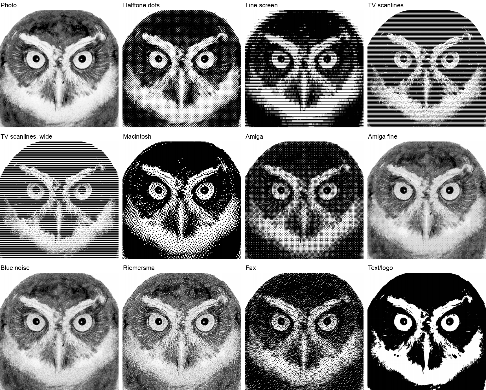

| Look           | How it works                                                                 |
|----------------|------------------------------------------------------------------------------|
| Photo          | *Fine*: the printer's 16 gray levels, Floyd–Steinberg error diffusion between them. *Coarse*: Atkinson error diffusion to black and white with tones corrected by the printer's measured response (see below); light tones pass on the full error, so highlights keep a few dots instead of burning out, while paper white stays blank. |
| Halftone dots  | Round dots on a 45° screen, about 0.5 mm pitch                               |
| Line screen    | Horizontal lines, 0.6 mm apart; the line thickness carries the tone (engraving style) |
| TV scanlines   | The picture sits in bands of dot rows with a white gap: 4 + 2 rows, or 6 + 4 rows for *wide*. Dot spread closes about one row of the gap, so the wide version is the one that shows on small labels. |
| Macintosh      | Atkinson dithering at 72 dpi, one screen pixel = 4 × 4 printer dots          |
| Amiga          | 4 × 4 Bayer ordered dither on 2 × 2 dot cells, the familiar cross-hatch. Tone-corrected only once calibrated |
| Blue noise     | A 64 × 64 blue-noise threshold map (void-and-cluster): like Bayer, every tone has one fixed pattern, but without a visible grid. Calibratable like Amiga fine |
| Riemersma      | Error diffusion along a Hilbert curve (last 32 dots, exponential weights): organic texture without rows |
| Amiga fine     | 8 × 8 Bayer on single dots: the same cross-hatch at twice the resolution and 65 instead of 17 tones, with the measured tone correction of the photo look |
| Fax            | 150 × 100 dpi cells, close to fax standard resolution, with Floyd–Steinberg diffusion |
| Text/logo      | Hard threshold, for line art and logos                                       |

Close-up, about twice the printed size:

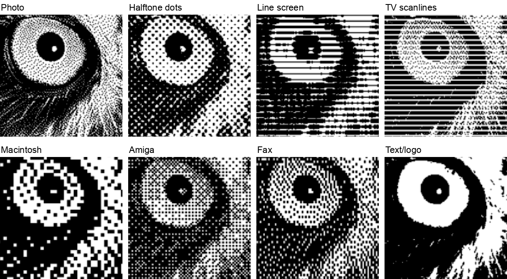

The other looks are black-and-white patterns by nature and always print in 1-bit, also in *Fine*.

### Gray mode

The B21 Pro has a 16-level gray mode. Each dot gets one of 16 heat levels, so tones no longer depend
on dot patterns and dot spread. The app diffuses the photo to 16 levels and spreads the tone target
(gamma, see below) over them by how dark each level actually prints. Without a paper profile the
levels measured on an original roll apply (`PrintCurve.GRAY`), with one the paper's own (see
*Calibration*). Printing takes about four times as long as 1-bit.

The manufacturer's app offers gray only on NIIMBOT's dedicated gray rolls. B21 Print prints gray on
any plain label: third-party rolls and NIIMBOT's standard RFID rolls alike. This needs a printer
firmware with at least the RFID roll check removed; on the original firmware such rolls print very
faint (see *Requirements*).

How many of the 16 levels show depends on the printer firmware, not on the app:

- **Original firmware**: the low levels get so little heat that levels 1 to 6–9 leave no mark on the
  rolls tried so far, so about six tones are left; light tones become sparse dots of the lightest
  level that marks. Rows with many dark dots also print lighter than rows with few, because the
  printer makes up too little for the voltage drop. The app works fine with it; gray photos simply
  have fewer tones.
- **Patched firmware** (released separately, not part of the app): spreads the heat of the 16 levels
  over the range the paper actually reacts to and compensates rows with many dots properly. On a
  third-party 40 × 40 mm roll about ten levels then print as distinct tones, the same tone prints
  alike in a small detail and a large area, and photos keep their mid tones.

After changing the firmware, calibrate the paper profile again: the levels print differently.

### Tone correction (1-bit)

Thermal dots spread into their neighbours, and not evenly: measured with the calibration chart,
isolated dots print about as dark as their share of the area, but from roughly 25 % coverage on they
merge, and below tone ~110 everything prints solid black. The photo look therefore corrects tones
with a table measured per print density (`PrintCurve.kt`) instead of a formula: for each photo tone
it picks the dither input that prints the intended darkness, and the preview uses the same
measurement. The intended darkness is linear in the photo tone (tone 128 prints half dark); chosen
from a tone-sweep print, darker targets closer to the screen's sRGB curve looked grey and flat on
thermal paper.

Halftone dots and TV scanlines still use a simple dot-gain formula. Line screen, Macintosh, Amiga
and fax are built from thick lines or blocks of dots and are not corrected. *Amiga* can be
calibrated (see *Calibration*); with a measured curve it is corrected like the photo look.

## Settings

<p>
  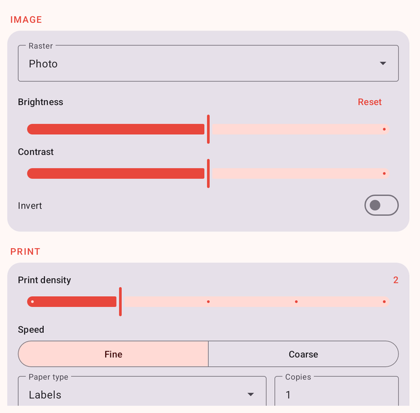
  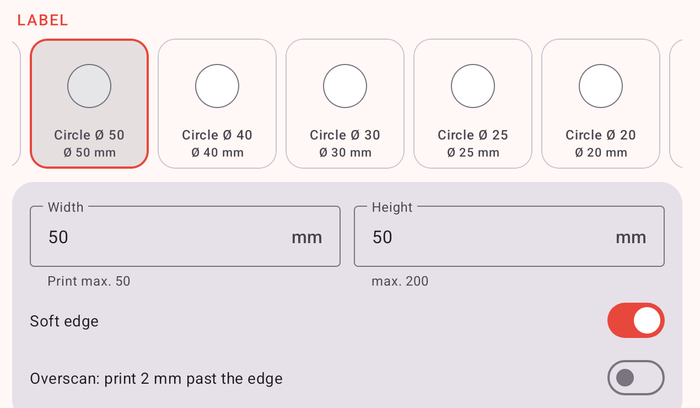
</p>

- **Raster**: the look, see above.
- **Favourites**: chips above the look. *Save as favourite* stores look, print mode, density,
  brightness and contrast; tapping a chip applies it, a long press deletes it.
- **Brightness / Contrast** (current value next to the name): applied after an automatic levels step that stretches the photo to
  full range. Only the brightest 0.1 % may clip to white, so light grey stays distinguishable from
  paper white. Both are curves: brightness bends the mid-tones, contrast is an S-curve around
  mid-grey. Raising either also clips the lightest tones to paper white (up to 15 % of the range),
  so an off-white background can be made to print white; lowering brightness clips the darkest
  tones to black.
- **Invert**: swap black and white.
- **Soft edge**: fade to white over the outer eighth of the photo area. The fade is applied after
  the tone curve, so it does not change the brightness of the rest of the photo.
- **Background** (only for photos with a depth map, see below): splits the photo into subject and
  background by distance. *Subject reaches to* sets the boundary (in % of the photo's depth range;
  it starts where the depth splits best into near and far). The background can print *lighter* or
  *darker* (with a strength), in *another raster* (e.g. subject *Amiga fine*, background *Blue
  noise*, as in the game Return of the Obra Dinn), or on a black + red roll *red* (or black with the
  subject red); then the depth decides the colour and *Red tones* is hidden. Works in gray mode too.
- **Overscan** (round labels): print 2 mm instead of 0.6 mm past the rim. Memory Film has no
  overscan: its frame is thermal paper too, and print outside the window would grey it.
- **Print density**: heat level sent to the printer. 1–2 suits photos on original rolls.
- **Print mode**: *Fine* prints photos in 16 gray levels, *Coarse* as 1-bit dots (the classic
  thermal look, and faster). Raster looks other than *Photo*, signs and the calibration chart are
  always 1-bit.
- **Paper type**: how the printer finds the next label (gap, black mark, continuous, transparent).
- **Paper profile**: tone curves measured on a roll type in the app (see *Calibration*). *Standard*
  uses the built-in defaults. A profile saved while a roll with an RFID tag was in the printer is
  selected again whenever a roll with the same barcode is found on connecting; rolls without a tag
  are picked by hand.
- **Black + red roll**: for two-colour rolls. Set on connecting when the roll's RFID tag shows a
  two-colour roll (known barcodes, or the setting last used with that roll): printed in the
  black-only modes, a two-colour roll comes out a faint red. Prints 1-bit; every dot is either red or black.
  *Red tones* selects a band of image tones (0 % = black, 100 % = white) that prints red, the rest
  prints black, a bit like split toning. The band edges blend softly. The colour is decided on a
  slightly blurred image and blended in 2 × 2-dot cells, because a red dot next to a black one turns
  black (the heat spreads) and fine red/black mixtures print as a muddy brown. Signs print black.

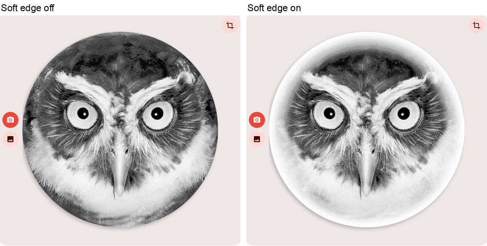

### Depth map

Samsung phones store a depth map in photos taken in portrait mode ("Live focus"): 8 bits per pixel
(1024 × 768 for 4:3), appended to the JPEG in Samsung's trailer (SEF: the file ends with `SEFT`, a
directory `SEFH` lists the blocks, the map is `DualShot_DepthMap_1`, dark = near). The app reads it
when it loads such a photo, stretches it to the photo's depth range and turns and crops it along
with the photo; it is laid over the label exactly like the photo. Other phones' depth formats
(Google's Dynamic Depth) are not read.

### Calibration

*Paper profile → Calibrate…* measures the current print mode at the current density on the loaded
paper, without a computer:

1. *Print chart*: corner squares, the steps to measure and the settings as text. Needs a plain
   label of at least 30 × 30 mm. In *Coarse*: 5 × 5 patches of 25 tones with white gutters, dithered
   with the selected look (photo, *Amiga*, *Amiga fine*, *Blue noise* or *Riemersma*). In *Fine*: one
   band per gray level across the whole width ("CAL 16B"). A grid of patches misreads the gray
   levels, since the right side of the head prints darker and each patch would only see its own
   spot; a band averages over the head.
2. *Camera* (or *Gallery*): a photo of the whole label in even, indirect light. The app finds the
   corner squares, maps the chart into the photo in any orientation, and measures each patch
   against the white around it (a band against the white left and right of it), so uneven light
   across the label cancels out.
3. Check the outlined patches on the rectified chart and the measured curve, name the profile and
   save. The curve belongs to that mode, look and density; other densities keep the defaults until
   they are measured too. Below the profile field the app shows whether the current settings have a
   measured curve. *Amiga fine*, *Blue noise* and *Riemersma* without their own curve use the photo
   curve; *Amiga* (2 × 2 blocks, which merge far less than single dots) stays uncorrected.

Gray uses the measured levels when diffusing (levels that print alike are simply skipped), 1-bit
uses the measured table in place of the built-in one, and the preview follows both. Phone photos
crush the darkest tones, so the shadow end is less reliable than the rest. Red/black rolls cannot be
calibrated yet.

Signs use the same label and print settings:

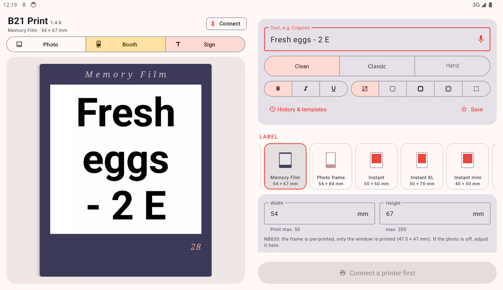

## Photo booth

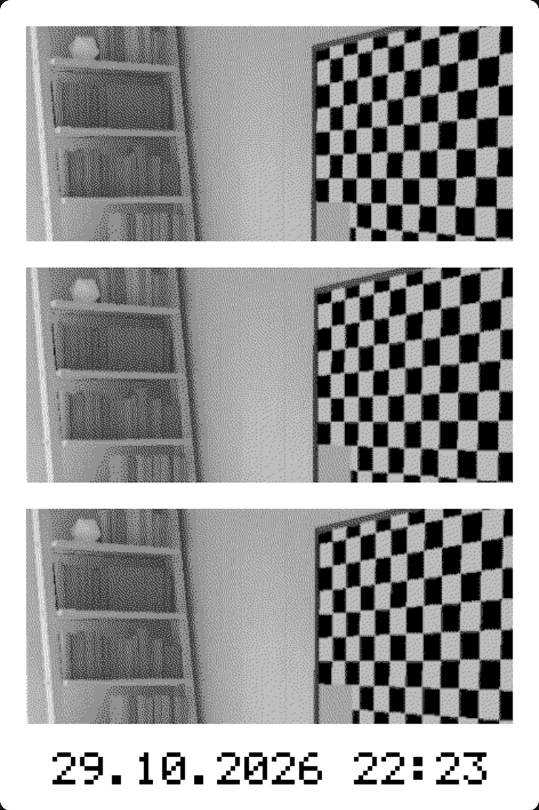

The booth takes the picture series, builds the layout at print resolution (`PhotoStrip.kt`) and
sends it through the same pipeline as any photo, so raster look, density and print mode apply to the
whole strip. The pictures are cut to the shape of one tile; the viewfinder frame shows that shape.
Landscape labels and round labels only take single pictures.

## Requirements

- Android 9 or newer with Bluetooth LE
- A NIIMBOT B21 Pro (other B21 variants may work, untested)

The app works with the printer's original firmware; nothing in it needs a patched one. It does not
check the roll's RFID tag; it only reads the barcode to pick a paper profile. On the original
firmware, rolls without a valid NIIMBOT tag still print very faint, because the printer firmware
itself lowers the heat; the app cannot change that. With a patched printer firmware, released
separately, they print normally and the gray mode has more tones (see *Gray mode*).

## Install

Download the APK from the [releases](../../releases) and install it (allow installing from unknown
sources). Then tap *Connect*; the app scans for printers whose name starts with `B21`.

From 1.3.1 on, release APKs are signed with the project's release key. Certificate SHA-256:

```
d0:03:0d:5d:c9:1c:a5:ae:65:1e:fc:24:09:15:70:18:31:2d:6a:02:6d:2c:f7:10:bc:c4:dc:c1:5f:a8:f6:d2
```

Versions 1.0 and 1.3 were signed with a debug key. Android does not install an update signed with
a different key, so uninstall the old version once before installing 1.3.1. This resets the app's
settings, sign history, templates and Memory Film offsets.

## Build

JDK 17 and the Android SDK (API 34) are required.

```sh
./gradlew assembleDebug
# app/build/outputs/apk/debug/app-debug.apk
```

### Signing

`./gradlew assembleRelease` signs with the key configured in `~/.gradle/gradle.properties`, or with
the local debug key if there is none. The key never goes into the repository.

To sign with your own key, create it once (keep the file and password safe; without them you
cannot publish updates):

```sh
keytool -genkeypair -keystore ~/.android/b21print-release.jks -alias b21print \
        -keyalg RSA -keysize 4096 -validity 36500 -dname "CN=B21 Print"
```

and add to `~/.gradle/gradle.properties`:

```properties
B21_KEYSTORE=~/.android/b21print-release.jks
B21_KEYSTORE_PASSWORD=...
B21_KEY_ALIAS=b21print
B21_KEY_PASSWORD=...
```

The output is `app/build/outputs/apk/release/app-release.apk`. Android only installs an update if
it is signed with the same key as the installed app, so your own builds and the release APKs
cannot replace each other.

## Debug console

Long-press the *B21 Print* title. With a printer connected, the console sends raw text commands to
the BLE characteristic and shows every reply. It also offers:

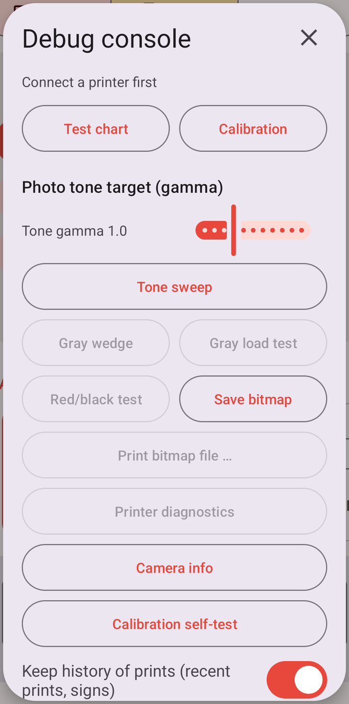

- **Test chart**: loads a chart sized to the current photo area (window, instant frame or circle)
  into the preview, as if it were a cropped photo: tone wedge, gradient, dither patches, line and
  checkerboard resolution, Siemens star, rings and microtext. Works without a printer.
- **Calibration**: a 5 × 5 chart of flat tones, already dithered and printed dot for dot without
  any image processing, with the density printed on it. It measures the 1-bit mode. `tools/calib.py` reads a photo of
  it and reports how dark each patch printed; those numbers are the tables in `PrintCurve.kt`.
  For a paper profile use *Calibration* in the paper profile dialog instead, which does the same
  in the app.
- **Tone gamma**: the tone target for photos, darkness = 1 − tone^gamma (1.0 = linear, the
  default), for both print modes. Remembered.
- **Tone sweep**: prints the current photo in four vertical stripes with different tone targets
  around the current gamma (−0.3, ±0, +0.3, +0.6, labelled at the top), to choose from one print.
- **Gray wedge**: prints 16 flat gray levels, a smooth ramp diffused to 16 levels and the same
  ramp in black and white only, straight to the printer.
- **Gray load test**: a light, a mid and a dark gray level, each as a patch alone, with the same
  level running on over half the width and over the whole width. If the printer compensates rows
  with many dots correctly, the three patches of a level look alike; on the original firmware the
  ones next to the long bands print lighter. For comparing printer firmware.
- **Red/black test**: black ramp, red ramp, both side by side, 8-dot stripes and a 1-dot
  checkerboard in red and black.
- **Save print bitmap** / **Print bitmap file**: the dots of the current print as a PNG (1:1, gray
  levels as gray, no red) and the other way round, a PNG sent as a 1-bit print. For checking
  patterns without paper; for repeating a print use *Recent prints* instead.
- **Heartbeat 2 / 3 / 4**: the other heartbeat requests; the replies are shown raw. Type 1 (battery,
  voltage, temperature) runs by itself and fills the battery line in the main window.
- **Printer diagnostics**: queries RFID, anti-fake and status data and writes the raw replies to
  the console log and the log at the bottom of the main screen.
- **Flash firmware**: sends a `.bin` firmware image over Bluetooth. The version is taken from the
  file name (e.g. `B21_Pro_3.10.bin` → 3.10). The printer verifies the image before committing it;
  a rejected or interrupted transfer leaves the old firmware running. Do not switch the printer off
  during the update.
- **Log** with copy and clear buttons; it also shows the app's own log lines while open. The same
  lines go to Android's log under the tag `B21`, so `adb logcat -s B21` shows them live.

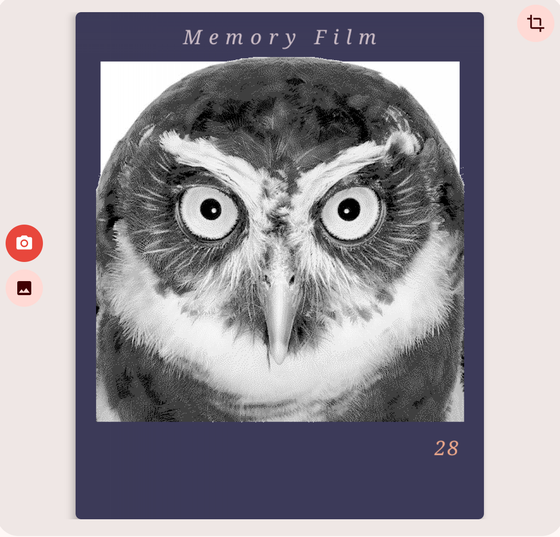

`tools/mkchart.py` generates the same chart as a PNG for any label size.

## Protocol notes

- BLE service `e7810a71-73ae-499d-8c15-faa9aef0c3f2`, characteristic
  `bef8d6c9-9c21-4c9e-b632-bd58c1009f9f`
- Packets: `55 55 CMD LEN DATA… XOR AA AA`
- The B21 Pro uses the "V4" print sequence (print start with copies, speed and quality bytes, a
  13-byte page size, no page start). The app falls back to older sequences if the printer rejects
  it and remembers what worked.
- 300 dpi, 591-dot print head (50 mm). Rows are sent as bitmap rows with per-third dot counts;
  identical rows are merged. (The manufacturer's app sends 1-bit rows only as wide as the label,
  colour mode 2 and three counts per 24 bytes; none of that changed the print here.)
- Gray and red/black mode (worked out from the printer's Bluetooth traffic): the colour mode
  is a byte of the print start (3 = gray, 1 = red/black), the width is 576 dots.
  - Gray rows: `55 55 8D LEN(u16) 86 row(u16) 01 N runs… data… XOR AA AA`, data 4 bits per dot
    (0 = white, 15 = black), runs (a, b) repeat the last dot (a & 0xFE) − 2 more times after data
    byte ((a & 1) << 8) | b. Empty rows: `8D … 84 row(u16) count 00`.
  - Red/black rows: `55 55 8A LEN plane …`, one command per row: plane 1 = red only, 2 = black
    only (`85 row(u16) 01` + 72-byte bitmap), 3 = both (`row(u16) 01` + bitmap of all dots + one
    mask byte per non-zero byte, 1 = red). A row number sent twice stops the printer.
  - These modes print slower than BLE delivers, and the printer drops rows silently once its
    buffer is full. Rows go out in blocks of 100; before each block the status reply (bytes 4–5:
    free rows) is polled until there is room.
- The printer often drops the first packet after a pause, so every job starts with a heartbeat.
- Firmware updates use a separate framing with a CRC-32 instead of the XOR checksum:
  `55 55 CMD chunkHi chunkLo LEN DATA… CRC32 AA AA`, 200-byte chunks.

The protocol work of [niimbluelib](https://github.com/MultiMote/niimbluelib) by MultiMote was the
main reference.

## Code

| File                             | Purpose                                                        |
|----------------------------------|----------------------------------------------------------------|
| `Niimbot.kt`                     | packet encoding and parsing, row encoding (1-bit, gray, red/black) |
| `B21Printer.kt`                  | BLE connection, print sequence, firmware update                |
| `ImageProcessor.kt`              | scaling, tone curve, dot gain, raster looks, gray levels, red band, frame and window composition |
| `PrintCurve.kt`                  | measured tone response per density, tone correction table     |
| `DepthMap.kt`                    | reads the depth map of Samsung portrait photos                 |
| `PaperProfile.kt`                | paper profiles with their measured curves, stored in the preferences |
| `ChartReader.kt`                 | reads a photo of a calibration chart (in-app `tools/calib.py`) |
| `TestChart.kt`                   | built-in test chart (port of `tools/mkchart.py`), calibration charts, gray wedge and load test |
| `TextLabel.kt`                   | sign rendering, QR code                                        |
| `PrintArchive.kt`                | the last 20 prints as finished dots, for printing again        |
| `PhotoStrip.kt`                  | photo booth layouts (strip, grid), pixel-font text            |
| `Labels.kt`                      | label presets                                                  |
| `MainActivity.kt`                | main screen                                                    |
| `CropActivity.kt`, `CropView.kt` | crop screen                                                    |
| `BoothActivity.kt`               | photo booth                                                    |

The pixel font (5 × 7, upper case) is `TestChart.FONT`; it is used for the stamp, the strip's date
line and the labels on the calibration charts.

[history.md](history.md) records how the image pipeline got where it is, [backlog.md](backlog.md)
lists what is still open.

## Disclaimer

Not affiliated with NIIMBOT, Apple or Commodore; the look names only describe the style. Use at your
own risk, especially the firmware flasher.
