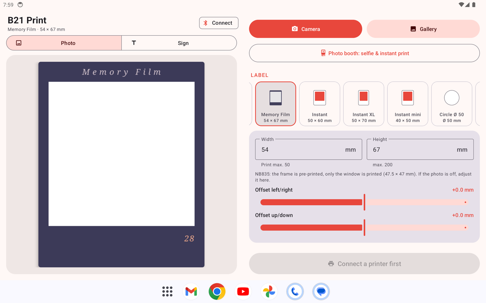
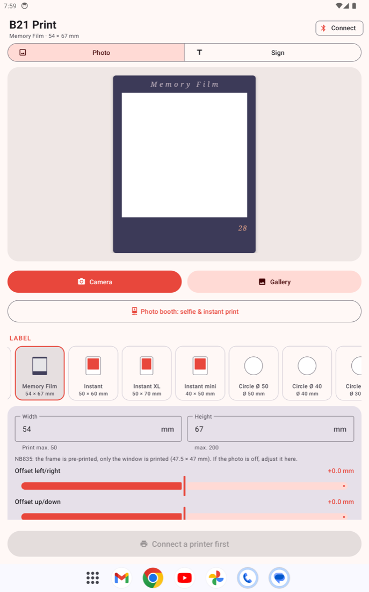

# B21 Print

A small Android app for the NIIMBOT B21 Pro label printer: print photos and text labels over
Bluetooth, without an account, cloud catalog or RFID roll check. Includes a photo booth mode
for tablets.

<p>
  
  
</p>

## Features

**Photos**
- Camera, gallery, or *Share* from any other app; crop with label-shaped or free framing
- Three raster modes: photo (Atkinson dithering), dots (halftone), text/logo (hard threshold)
- Brightness, contrast, invert
- Instant frame with an optional caption, printed by the app on plain labels
- NB835 *Memory Film* labels with a pre-printed frame: prints only into the window, with
  per-label offset fine-tuning that is remembered

**Signs**
- Short text, centered and automatically sized, 1–3 lines
- Three fonts, bold/italic/underline, five frame styles
- Voice input
- History of the last 50 printed signs and saved templates

**Photo booth**
- Full-screen front camera with the printable area marked
- Countdown (off/3/5/10 s) and screen flash
- Review before printing: delete or print, then print again or take the next photo
- Uses the label, frame, caption, tone and density settings from the main screen
- Volume keys and Bluetooth selfie remotes work as a shutter

**Labels**
- Presets for common B21 sizes (rectangular, square, round, instant-style) and a custom size
  (print width up to 50 mm, length up to 200 mm)
- Gap, black mark, continuous and transparent paper; multiple copies
- Density 1–5 and two print speeds (fine/fast), both printer-side; dot-gain compensation on the
  image side so the print matches the preview

**Layout**
- Phone, tablet portrait and a two-column tablet landscape layout
- English and German UI

## Requirements

- Android 9 or newer with Bluetooth LE
- A NIIMBOT B21 Pro (other B21 variants may work, untested)

The app does not check the roll's RFID tag. On stock firmware, rolls without a valid NIIMBOT tag
still print very faint because the printer firmware itself lowers the heat; the app cannot change
that. With a patched printer firmware they print normally.

## Install

Download the APK from the [releases](../../releases) and install it (allow installing from
unknown sources). Then tap *Connect*; the app scans for printers whose name starts with `B21`.

The release APK is signed with a debug key. Uninstall it before installing a build signed with a
different key.

## Build

JDK 17 and the Android SDK (API 34) are required.

```sh
./gradlew assembleDebug
# app/build/outputs/apk/debug/app-debug.apk
```

## Debug console

Long-press the *B21 Print* title (with a printer connected). The console sends raw text commands
to the BLE characteristic and shows every reply. It also has:

- **Printer diagnostics:** queries RFID, anti-fake and status data and writes the raw replies to
  the log at the bottom of the main screen.
- **Flash firmware:** sends a `.bin` firmware image over Bluetooth. The version is taken from the
  file name (e.g. `B21_Pro_3.10.bin` → 3.10). The printer verifies the image before committing it;
  a rejected or interrupted transfer leaves the old firmware running. Do not switch the printer off
  during the update.

## Protocol notes

- BLE service `e7810a71-73ae-499d-8c15-faa9aef0c3f2`, characteristic
  `bef8d6c9-9c21-4c9e-b632-bd58c1009f9f`
- Packets: `55 55 CMD LEN DATA… XOR AA AA`
- The B21 Pro uses the "V4" print sequence (print start with copies and quality bytes, a 13-byte
  page size, no page start). The app falls back to older sequences if the printer rejects it and
  remembers what worked.
- 300 dpi, 591-pixel print head (50 mm). Rows are sent as bitmap rows with per-third pixel
  counts; identical rows are merged.
- The printer often drops the first packet after a pause, so every job starts with a heartbeat.
- Firmware updates use a separate framing with a CRC-32 instead of the XOR checksum:
  `55 55 CMD chunkHi chunkLo LEN DATA… CRC32 AA AA`, 200-byte chunks.

The protocol work of [niimbluelib](https://github.com/MultiMote/niimbluelib) by MultiMote was the
main reference.

## Code

| File                 | Purpose                                                     |
|----------------------|-------------------------------------------------------------|
| `Niimbot.kt`         | packet encoding and parsing, row encoding                   |
| `B21Printer.kt`      | BLE connection, print sequence, firmware update             |
| `ImageProcessor.kt`  | scaling, tone curve, dot-gain, dithering, frame/window composition |
| `TextLabel.kt`       | sign rendering                                              |
| `Labels.kt`          | label presets                                               |
| `MainActivity.kt`    | main screen                                                 |
| `CropActivity.kt`, `CropView.kt` | crop screen                                     |
| `BoothActivity.kt`   | photo booth                                                 |

## Disclaimer

Not affiliated with NIIMBOT. Use at your own risk, especially the firmware flasher.
